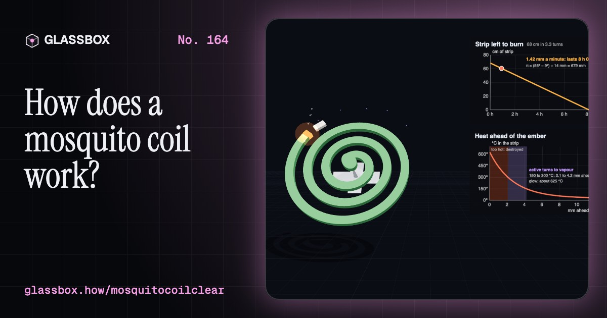
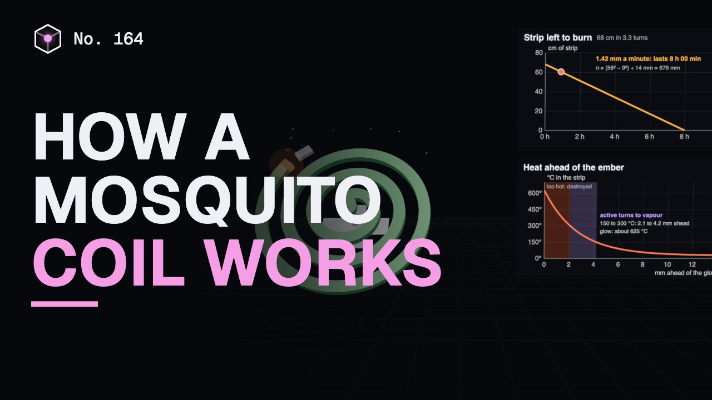
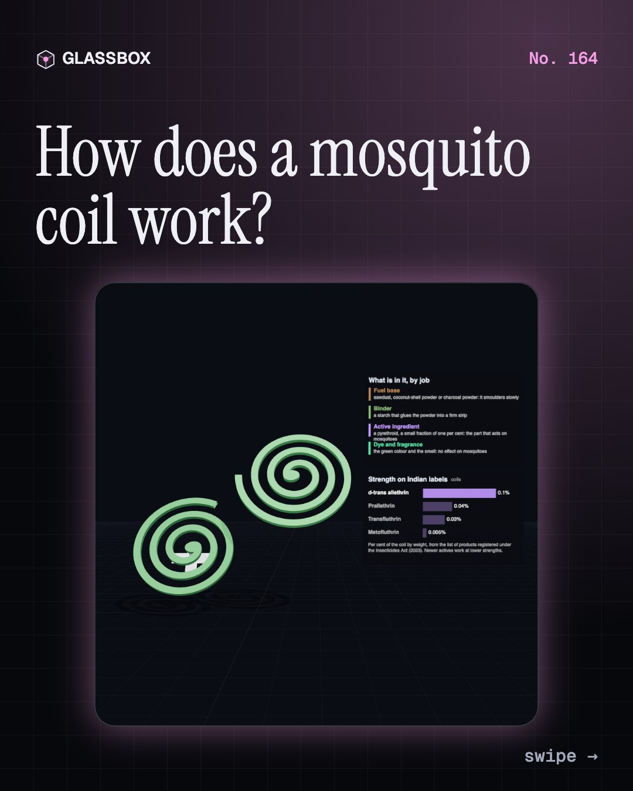
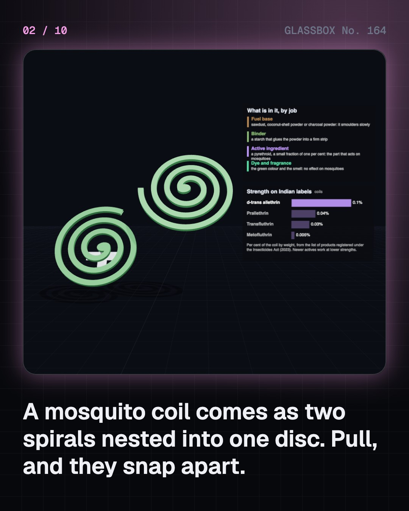
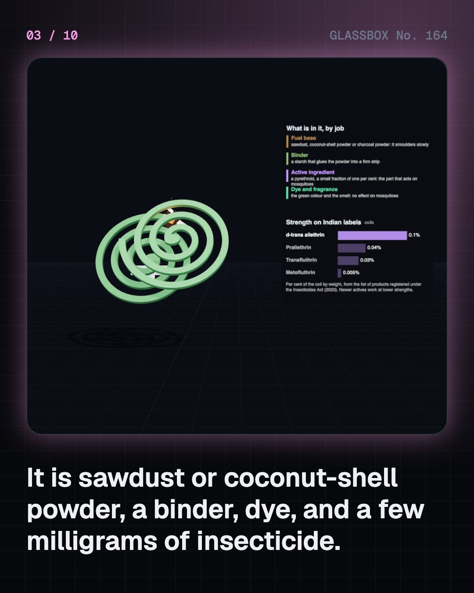
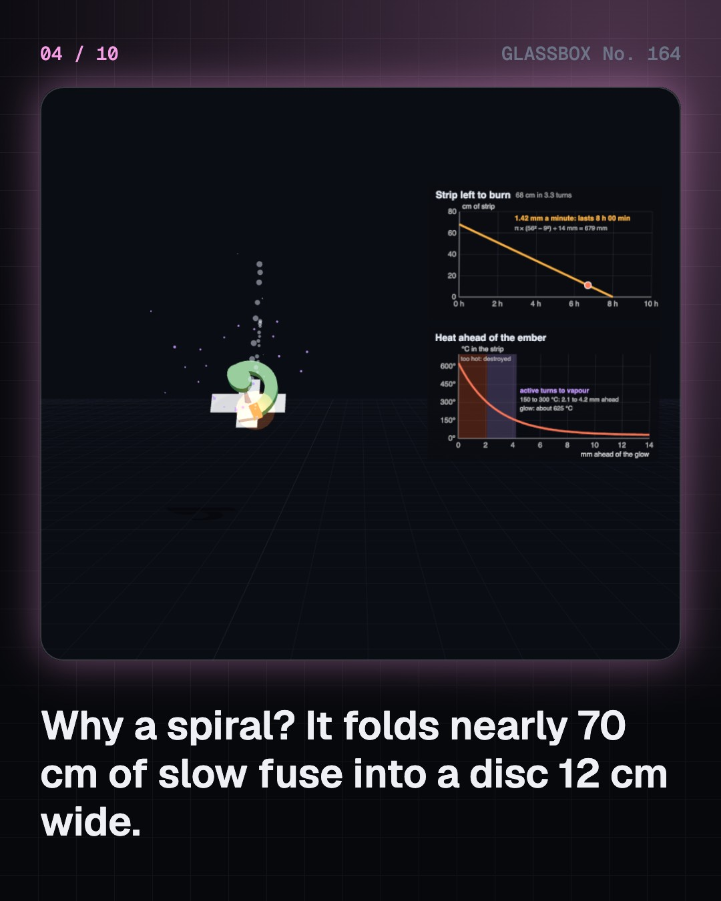

<!-- glassbox:start -->
<!-- Generated from glassbox.json by the Glassbox hub (npm run readme -- mosquitocoilclear). Edit glassbox.json, not this block. -->
<p align="center"><a href="https://glassbox.how/e/mosquitocoilclear/"></a></p>

<h1 align="center">MosquitoCoilClear</h1>

<p align="center"><b>How does a mosquito coil work?</b><br>A mosquito coil is a slow fuse wound into a spiral: nearly 70 cm of pressed powder that an ember crosses at 1.4 mm a minute, warming a few milligrams of insecticide into the air just ahead of itself. See why it is a spiral, what the vapour does to a mosquito's nerves, and why opening a window cuts the smoke and the protection by exactly the same share.</p>

<p align="center"><a href="https://glassbox.how/mosquitocoilclear/"><b>▶ Play with it</b></a> &nbsp;·&nbsp; <a href="https://glassbox.how/e/mosquitocoilclear/">Read the 60-second explainer</a> &nbsp;·&nbsp; <a href="https://glassbox.how/mosquitocoilclear/glassbox/reel.mp4">Watch the 40-second video</a></p>

<p align="center">
  <a href="https://glassbox.how/e/mosquitocoilclear/"></a>
  <a href="https://glassbox.how/e/mosquitocoilclear/"></a>
  <a href="LICENSE"></a>
  <a href="LICENSE-CONTENT.md"></a>
  <a href="#privacy"></a>
</p>

## In 60 seconds

1. **Two spirals, a stand and an ember.** A coil comes as a flat disc that is really two spirals nested together; you snap them apart and stand one on a metal prong. It is a slow-burning base of sawdust, coconut-shell powder or charcoal powder, a binder, dye and fragrance, and the part that matters: a synthetic pyrethroid insecticide. Indian labels show 0.005% to 0.1% for the common coils, so a 13 gram coil carries only a few milligrams.
2. **A night-long fuse in a 12 cm disc.** The length of a spiral is very nearly the area of its ring divided by the spacing of its turns: about 68 cm for a common coil. The ember creeps at about 1.4 mm a minute, so the coil lasts about eight hours. The glow itself would destroy the insecticide, but heat runs a few millimetres ahead of it, and at 150 to 300 °C the active turns to vapour and leaves before the fire arrives.
3. **Gates held open.** A mosquito finds you by the carbon dioxide in your breath from 10 to 50 metres, by your shape from 5 to 15 metres and by your warmth in the last metre. Her nerves fire using sodium channels that open for a thousandth of a second. A pyrethroid holds them open, so one touch becomes a burst of signals: at a faint dose she is restless and fails to bite, at a higher dose she is knocked down. Insect channels grip pyrethroids about a thousand times more strongly than mammal ones, and a warm body and a liver do the rest. Cats and fish are sensitive.
4. **The window cuts both.** A coil adds two things to a room: the vapour, and smoke. Chamber tests found 63 to 127 mg of fine particles (PM2.5) an hour from ordinary coils, enough to lift a shut 30 m³ bedroom into the thousands of micrograms per cubic metre, against a WHO guideline of 15 for a day's average. One coil gives off as much PM2.5 mass as 75 to 137 cigarettes, which measures the dust released, not what a sleeper breathes. Fresh air removes the same share of smoke and vapour: there is no setting that clears one and keeps the other.
5. **The same idea without the ember, and without the chemical.** Liquid vaporisers and mats warm a similar active with a small electric heater, so there is no smoke from burning. Nets, screens, fans and emptying standing water add nothing to the air at all, and a treated bed net is the WHO's main recommendation where malaria spreads. Coils do cut bites, but a Cochrane review found we do not know whether they prevent malaria. Ultrasonic gadgets have failed every fair field test.
6. **Rules, care and resistance.** In India a coil is an insecticide product under the Insecticides Act, 1968: it must be registered, and the pack must show the active, its strength and a registration number. Use it on its stand, away from bedding, with some fresh air. Where pyrethroids are used heavily, mosquitoes carrying a slightly different sodium channel survive and multiply; this knock-down resistance has been found in India's malaria and dengue mosquitoes. India reported about 2.6 lakh malaria cases and 2.3 lakh dengue cases in 2024.

## Words worth knowing

| Term | Meaning |
|---|---|
| **Mosquito coil** | A spiral of pressed, slow-burning powder that carries a little insecticide and smoulders for hours. |
| **Pyrethroid** | A synthetic insecticide modelled on pyrethrins, the natural insect-killers of pyrethrum daisies. |
| **Archimedean spiral** | A spiral with evenly spaced turns; its length is about the area of its ring divided by the spacing. |
| **Smoulder** | Burning without a flame: a glowing ember creeping through a solid. |
| **Sodium channel** | A protein gate in a nerve's membrane that opens briefly to make a voltage spike. Pyrethroids hold it open. |
| **Spatial repellency** | Mosquitoes avoiding or leaving a space because of a chemical in its air. |
| **PM2.5** | The mass of particles finer than 2.5 micrometres in a cubic metre of air. |
| **Air changes per hour** | How many room-fulls of fresh air replace the old air each hour. |
| **Knock-down resistance (kdr)** | A small change in an insect's sodium channel that makes pyrethroids bind less well, spread by selection. |

## A short history

**Two hundred years from a daisy ground into powder to a spiral that billions light at dusk, and the science still catching up with it.**

- **1886** · Seeds cross the Pacific (Eiichiro Ueyama and H. E. Amoore, Wakayama, Japan)
- **1890** · The first mosquito incense stick (Eiichiro Ueyama, Wakayama, Japan)
- **1895** · Yuki Ueyama suggests a spiral (Yuki Ueyama, Wakayama, Japan)
- **1897** · The mosquito is caught carrying malaria (Ronald Ross, Secunderabad, India)
- **1902** · The spiral coil goes on sale (Eiichiro and Yuki Ueyama, Osaka, Japan)
- **1949** · Allethrin: the first man-made pyrethroid (Milton S. Schechter and colleagues, United States)
- **1963** · The electric mat: vapour without an ember (Fumakilla, Hiroshima, Japan)
- **1967** · How it jams a nerve (Toshio Narahashi, Duke University, United States)

The full story, with 31 moments, charts, people and 43 sources: [glassbox.how/e/mosquitocoilclear/history](https://glassbox.how/e/mosquitocoilclear/history/). The data lives in [`history.json`](history.json).

## Video and slides

Made with the Glassbox studio from this box's storyboard (`window.glassbox.director`). Free to reuse under CC BY 4.0.

<a href="https://glassbox.how/mosquitocoilclear/glassbox/video.mp4"></a>

<p><a href="glassbox/slide-1.jpg"></a> <a href="glassbox/slide-2.jpg"></a> <a href="glassbox/slide-3.jpg"></a> <a href="glassbox/slide-4.jpg"></a></p>

| File | What | Size |
|---|---|---|
| [`glassbox/reel.mp4`](https://glassbox.how/mosquitocoilclear/glassbox/reel.mp4) | Reel / Short, with captions and soundtrack | 1080×1920 |
| [`glassbox/video.mp4`](https://glassbox.how/mosquitocoilclear/glassbox/video.mp4) | YouTube video, with captions and soundtrack | 1920×1080 |
| `glassbox/slide-1…10.jpg` | Instagram carousel | 1080×1350 |
| `glassbox/thumb.jpg` | YouTube thumbnail | 1280×720 |
| `glassbox/cover.jpg` | Share card and repo social preview | 1200×630 |
| [`glassbox/history-reel.mp4`](https://glassbox.how/mosquitocoilclear/glassbox/history-reel.mp4) | “History in 10 moments” Reel / Short | 1080×1920 |
| `glassbox/history-slide-*.jpg` | History carousel | 1080×1350 |
| `glassbox/post.json` | Post copy and schedule used by the publish kit | |

## Privacy

This box has no accounts and no ads, and it ships its own fonts and libraries. When you run it yourself it sends nothing anywhere. On glassbox.how, the site's `/bar.js` also loads Glassbox's analytics: **Google Analytics** to count visits (it asks first in the EU, UK and Switzerland, and stays off when your browser sends Global Privacy Control or Do Not Track) and **ClickTrust** to detect bots.

It remembers a few things **in your own browser only**, and never sends them anywhere:

| Browser storage key | What it holds |
|---|---|
| `mosquitocoilclear.v1` | Which chapters you have opened, your best quiz scores, and sound on or off. |

Exactly what each one sees is at [glassbox.how/privacy](https://glassbox.how/privacy/).

## Licences

- **Code:** [MIT](LICENSE). Use it, change it, ship it.
- **Explanations, text, images and videos** (`glassbox.json`, `glassbox/`): [CC BY 4.0](LICENSE-CONTENT.md). Credit “Glassbox, glassbox.how/e/mosquitocoilclear”.
- **Third-party parts** keep their own licences: [three.js](https://threejs.org) (MIT), [Geist, Instrument Serif](https://openfontlicense.org) (SIL OFL 1.1).
- The Glassbox name and logo aren't covered by either licence. See the [terms](https://glassbox.how/terms/).

Found a mistake? [Open an issue](https://github.com/bdeeps/mosquitocoilclear/issues). Corrections happen in public.
<!-- glassbox:end -->

## Run it

It's plain HTML, CSS and JavaScript. No build step and no dependencies. Run locally, it contacts no other website.

```bash
python3 -m http.server 8000
```

Three.js and the fonts ship in `vendor/` and `fonts/`, so it also works offline.

Then open http://localhost:8000.

## How it's built

| File | What |
|---|---|
| `index.html`, `css/app.css` | The page and its styles |
| `js/app.js`, `js/stage.js`, `js/ui.js`, `js/kit.js` | The shared Glassbox 3D engine: chapters, 3D stage, controls, quiz, video director |
| `js/coil.js` | This box's own helpers: the spiral, heat, room, nerve and resistance sums, chart boards, particles, the 3D coil and stand |
| `js/chapters/*.js` | One file per chapter: the 3D model, controls, text, key terms, quiz and video scenes |
| `glassbox.json` | Title, question, explainer beats, key terms, browser storage and credits shown on glassbox.how |
| `reel` in each chapter | The storyboard the Glassbox studio records into short videos |
| `glassbox/` | The published video, slides, thumbnail and post copy |
| `fonts/`, `vendor/three/` | Self-hosted Geist and Instrument Serif (SIL OFL 1.1) and three.js (MIT) |
